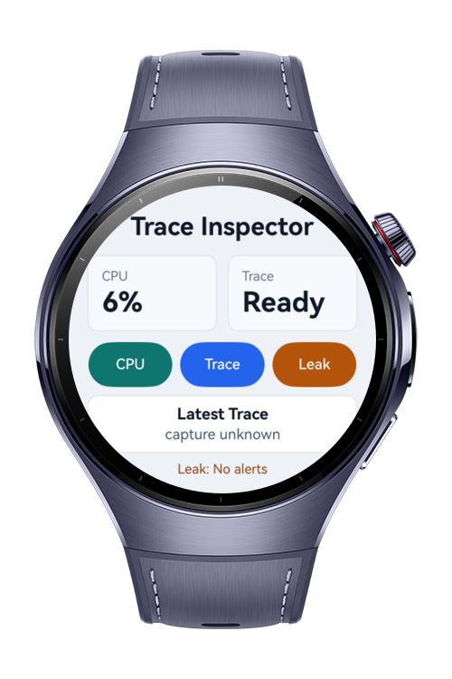
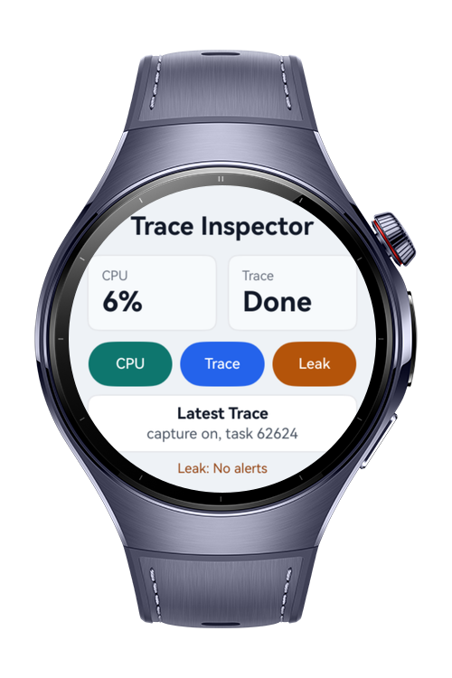

> **Note:** To access all shared projects, get information about environment setup, and view other guides, please visit [Explore-In-HMOS Index](https://github.com/Explore-In-HMOS/hmos-index).

# How to build Trace Inspector

This codelab showcases how to build a trace inspector on wearable using HarmonyOS NEXT APIs.

# Preview

<div>
    
    
    
    
</div>

# Use Cases

* Performance bottleneck detection
* Application debugging and troubleshooting
* CPU and thread activity analysis
* Performance optimization verification

# Tech Stack

- **Languages**: ArkTS, ArkUI
- **Frameworks**: HarmonyOS SDK 6.0.1(21)
- **Tools**: DevEco Studio Version 6.1.1
- **Libraries & Kits**:
    - `@kit.AbilityKit`
    - `@kit.ArkUI`
    - `@kit.BasicServicesKit`
    - `@kit.PerformanceAnalysisKit`

# Directory Structure

```
entry/src/main/ets/
|---pages
|   |---Index.ets
|---module.json5
```

# Constraints and Restrictions

## Supported Devices

- Huawei Watch 5
- DevEco Studio Emulator

# License

**How to build a Trace Inspector on Watch** is distributed under the terms of the MIT License
See the [license](./LICENSE) for more information.
